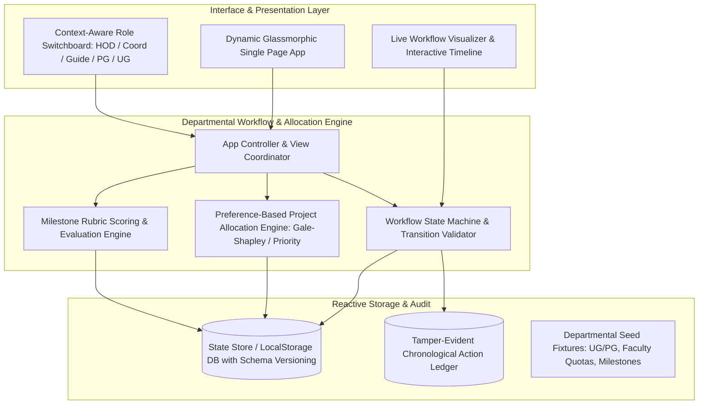
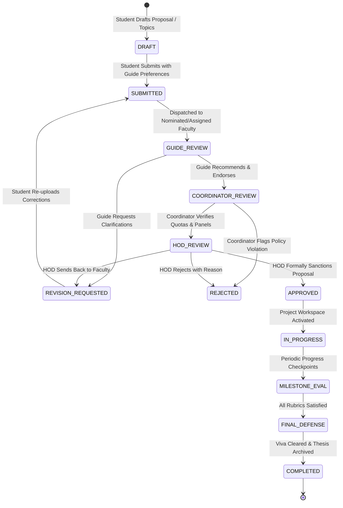

# DEPARTMENTAL ACTIVITY & WORKFLOW MANAGEMENT SYSTEM (DAWMS)
## Architecture, Workflow-Based Engine & Software Interface Design Specification

---

### Executive System Summary
**Project Title**: Departmental Activity & Project Allocation Workflow Management System (DAWMS)  
**Curriculum Reference**: B.Tech / M.Tech Computer Science & Information Technology Lab (Project VII / Capstone Stage)  
**Target Architecture**: Workflow-Driven State Machine with Role-Based Access Control (RBAC) & Service Interface Contracts  
**Platform**: Self-Contained Web Architecture (HTML5, Modern Reactive ES6+, Modular CSS3 Design Tokens)

---

## 1. Architectural Foundation & System Decomposition

### 1.1 Architectural Pattern: Event-Driven Workflow Engine
The system models departmental activities not as static database records, but as **stateful business processes** moving through deterministic lifecycle phases governed by transition guards, role permissions, and formal digital sign-offs.



---

## 2. Role-Based Access Control (RBAC) Matrix

| Operation / Feature | UG Student | PG Scholar | Faculty Guide | Project Coordinator | Head of Dept (HOD) |
|---|:---:|:---:|:---:|:---:|:---:|
| **Submit Capstone Proposal** | Write (Draft/Submit) | Read | Review/Endorse | Review/Verify | Read/Overview |
| **Submit PG Dissertation Topic** | No Access | Write (Draft/Submit) | Review/Endorse | Review/Verify | Final Clearance |
| **Project Topic Bidding** | Submit Choices | Submit Choices | Define Topics/Quotas | Configure Rules | Override / View |
| **Run Allocation Algorithm** | No Access | No Access | View Allotment | **Execute & Resolve** | Final Approval |
| **Milestone Rubric Evaluation** | View Feedback | View Feedback | **Grade & Feedback** | Monitor Deadlines | Endorse Grades |
| **RAC Progress Review (PG)** | No Access | Submit Report | Review/Comment | Schedule Panels | **Sign-off** |
| **Leave / On-Duty / NOC** | Submit Request | Submit Request | Initial Endorsement | Verification | **Final Approval** |
| **HPC / Lab Equipment Requisition** | Submit Request | Submit Request | Validate Need | Inventory Check | **Budget/Clearance** |
| **Department Audit & Analytics** | Personal Stats | Personal Stats | Group Analytics | Track Metrics | **Full Analytics** |

---

## 3. Workflow State Transition Engine

Every approval request conforms to a formalized finite state machine with strict pre-conditions and post-conditions.

### 3.1 State Diagram: Project Allocation & Approval Pipeline



### 3.2 State Transition Guard Rules
1. **Transition `DRAFT -> SUBMITTED`**:
   - Guard: All mandatory fields (Title, Abstract, Domain, Minimum 3 references, Member details for UG) must be validated.
2. **Transition `SUBMITTED -> GUIDE_REVIEW`**:
   - Guard: Actor must be the assigned guide or listed primary choice.
3. **Transition `COORDINATOR_REVIEW -> HOD_REVIEW`**:
   - Guard: Guide endorsement mark must be positive; quota checks must pass.
4. **Transition `HOD_REVIEW -> APPROVED`**:
   - Guard: Actor must hold the `HOD` role token; creates an immutable timestamped audit record.

---

## 4. Software Interface Design & Data Contract Specifications

### 4.1 Core Data Entity Schemas

#### A. Workflow Item Contract (`IWorkflowItem`)
```typescript
interface IWorkflowItem {
  id: string;                      // e.g., "WF-2026-UG-042"
  type: 'UG_PROJECT' | 'PG_DISSERTATION' | 'LEAVE_NOC' | 'LAB_EQUIPMENT';
  title: string;
  category: 'UG' | 'PG' | 'DEPARTMENTAL';
  submittedBy: {
    id: string;
    name: string;
    rollNo: string;
    email: string;
    degree: 'B.Tech' | 'M.Tech' | 'Ph.D';
    semester: number;
    teamMembers?: Array<{ name: string; rollNo: string }>;
  };
  details: {
    domain?: string;
    abstract?: string;
    proposedGuideId?: string;
    allocatedGuideId?: string;
    purpose?: string;
    fromDate?: string;
    toDate?: string;
    equipmentRequested?: string;
  };
  state: 'DRAFT' | 'SUBMITTED' | 'UNDER_GUIDE_REVIEW' | 'UNDER_COORDINATOR_REVIEW' | 'UNDER_HOD_REVIEW' | 'APPROVED' | 'REJECTED' | 'REVISION_REQUESTED';
  slaDaysRemaining: number;
  history: Array<{
    timestamp: string;
    actorId: string;
    actorName: string;
    actorRole: string;
    action: string;
    comment: string;
    statusFrom: string;
    statusTo: string;
  }>;
  milestones?: Array<{
    id: string;
    name: string;
    deadline: string;
    weightage: number;
    score?: number;
    maxScore: number;
    status: 'PENDING' | 'SUBMITTED' | 'EVALUATED';
    rubricScores?: Record<string, number>;
  }>;
}
```

#### B. Faculty Guide Quota & Expertise Contract (`IFaculty`)
```typescript
interface IFaculty {
  id: string;
  name: string;
  designation: string;
  specializations: string[];
  ugQuotaMax: number;
  ugQuotaCurrent: number;
  pgQuotaMax: number;
  pgQuotaCurrent: number;
  openTopics: string[];
}
```

---

## 5. Project Allocation Management: Algorithmic Logic

The system incorporates a **Priority & Preference Matching Engine** with constraint satisfaction:
1. **Student Preferences**: Ranked choices 1, 2, and 3 submitted by teams.
2. **Faculty Capacities**: Hard caps on UG teams (e.g., max 3) and PG scholars (e.g., max 2).
3. **Merit & Domain Alignment**: CGPA weighting + domain synergy score.
4. **Resolution Mechanism**: When over-subscribed, highest merit wins choice; secondary choices receive deterministic cascade; coordinator possesses manual override capability with audit justification.
